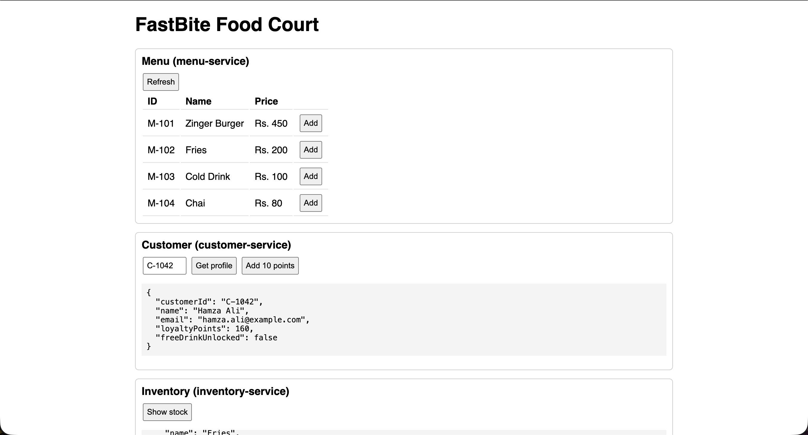

# Q2 – FastBite Campus Food-Court Ordering System

Microservice app (Node.js + Express + MongoDB), containerised with Docker, with a basic
web frontend and a GitHub Actions CI/CD pipeline.



## Architecture

```
browser -> frontend (nginx :8080) -> /api -> api-gateway (:3000) -> menu / order / inventory / customer / payment
                                                                  \-> each service has its own MongoDB database
```

| Folder              | Port | Responsibility                                     | Database             |
|---------------------|------|----------------------------------------------------|----------------------|
| `frontend`          | 8080 | Static page + nginx, proxies `/api/*` to gateway    | none                 |
| `api-gateway`       | 3000 | Single entry point, forwards to the right service   | none                 |
| `menu-service`      | 3001 | Menu items (name, price, availability)              | `fastbite_menu`      |
| `order-service`     | 3002 | Coordinates an order (menu, customer, inventory)    | `fastbite_orders`    |
| `inventory-service` | 3003 | Stock levels, refuses to oversell                   | `fastbite_inventory` |
| `customer-service`  | 3004 | Customer profile and loyalty points                 | `fastbite_customers` |
| `payment-service`   | 3005 | Checks amount against order, records payment        | `fastbite_payments`  |

Order flow: check customer -> validate items and price via menu -> reserve stock in
inventory (order rejected if short) -> award loyalty points (1 point per Rs. 10) -> status `CONFIRMED`.
Payment: amount must equal the order total -> order becomes `PAID`.

## Run with Docker

```
docker compose up --build
```

- Frontend: http://localhost:8080
- Gateway API: http://localhost:3000

If a port is already taken on your machine:

```
GATEWAY_PORT=3100 FRONTEND_PORT=8081 docker compose up --build
```

Stop and wipe data: `docker compose down -v`

## Demo data (seeded on first start)

- Menu/stock: `M-101` Zinger Burger Rs. 450, `M-102` Fries Rs. 200, `M-103` Cold Drink Rs. 100, `M-104` Chai Rs. 80
- Customers: `C-1042` Hamza Ali (150 points), `C-1043` Ayesha Khan (20 points)
- A free drink unlocks at 200 loyalty points.

## Frontend

One page (`frontend/index.html`, plain HTML/JS) with a section per service: view menu and add to cart,
customer profile / add points, inventory, place order, pay order, list orders and payments.

## API (via gateway)

| Method | Route                      | Body / notes                                              |
|--------|----------------------------|-----------------------------------------------------------|
| GET    | `/menu`                    | available menu items                                      |
| GET    | `/customers/:customerId`   | profile and loyalty points                                |
| POST   | `/customers/update-points` | `{ "customerId": "C-1042", "points": 65 }`                |
| GET    | `/inventory[/:itemId]`     | stock levels                                              |
| POST   | `/inventory/update`        | `{ "items": [ { "itemId": "M-101", "quantity": 1 } ] }`   |
| POST   | `/orders`                  | `{ "customerId": "C-1042", "items": [ { "itemId": "M-101", "quantity": 1 } ] }` |
| GET    | `/orders[/:orderId]`       | stored orders                                             |
| POST   | `/payments`                | `{ "orderId": "ORD-XXXXXXXX", "amount": 450 }`            |
| GET    | `/payments[/:orderId]`     | recorded payments                                         |

Every service also answers `GET /health`.

Quick test:

```
curl localhost:3000/menu
curl -X POST localhost:3000/orders -H 'Content-Type: application/json' \
  -d '{"customerId":"C-1042","items":[{"itemId":"M-101","quantity":1}]}'
```

## Configuration (environment variables)

All have defaults for local use; `docker-compose.yml` sets them for containers.

- Every service: `PORT`; all except gateway/frontend: `MONGO_URI`
- Menu, inventory, customer: `SEED_DATA=false` disables demo data
- Gateway: `MENU_SERVICE_URL`, `ORDER_SERVICE_URL`, `INVENTORY_SERVICE_URL`, `CUSTOMER_SERVICE_URL`, `PAYMENT_SERVICE_URL`
- Order: `MENU_SERVICE_URL`, `INVENTORY_SERVICE_URL`, `CUSTOMER_SERVICE_URL`; Payment: `ORDER_SERVICE_URL`
- Compose only: `GATEWAY_PORT` (default 3000), `FRONTEND_PORT` (default 8080)

## CI/CD (GitHub Actions)

Workflow: `.github/workflows/ci-cd.yml` (at the repo root).

1. **CI** (every push and pull request): builds all images with `docker compose`, starts the stack,
   smoke-tests `/health`, `/menu`, the frontend, and a full `POST /orders`.
2. **CD** (push to `main`, after CI passes): builds and pushes one image per service to GitHub
   Container Registry: `ghcr.io/<owner>/fastbite-<service>:latest`. Uses the built-in `GITHUB_TOKEN`.

## Deploy / publish to GitHub

```
git add . && git commit -m "Q2 cafe system" && git push origin main
```

Then see the **Actions** tab for the pipeline and **Packages** for the published images.

## Changes made to the starter code

- Moved `api-gateway` out of `inventory-service/` to the top level.
- Added a `Dockerfile` per service, `docker-compose.yml` (with Mongo), the frontend, and the CI/CD workflow.
